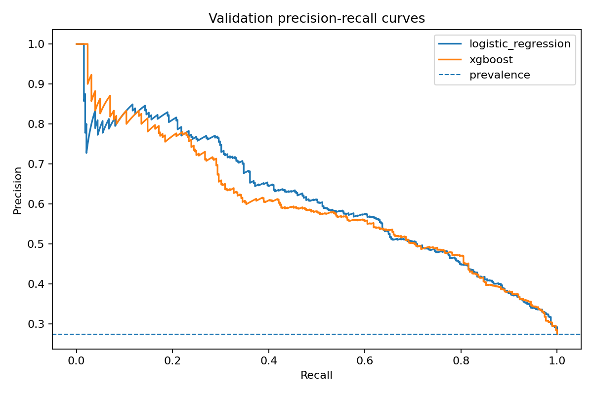
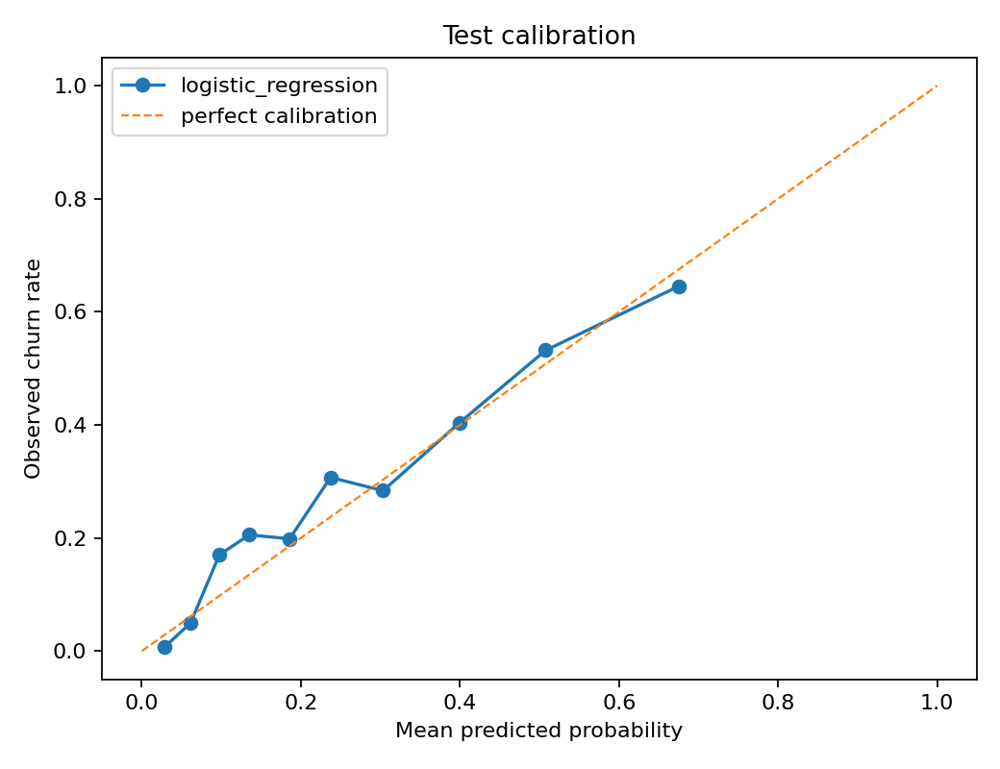
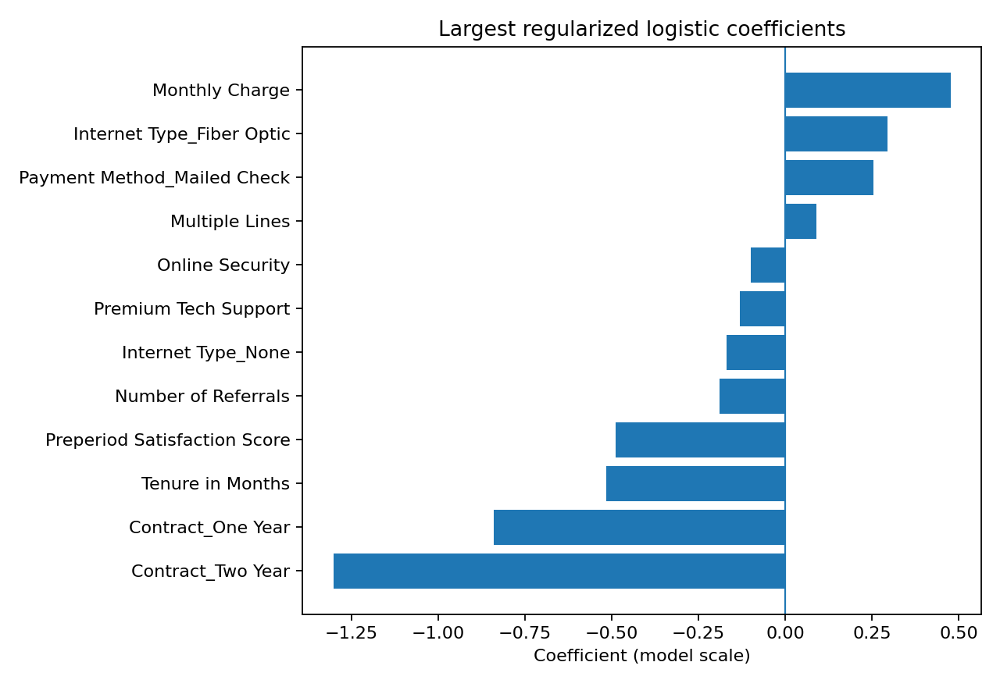

# TELCO Churn Analytics — Leakage-Aware Portfolio Reconstruction

A reproducible customer-churn case study rebuilt from an academic project into a cleaner public
Data Science portfolio artifact. The public data are fully synthetic and use a prediction-time
contract to prevent outcome leakage.

## Project status — Completed (19 October 2026)

**Status:** Completed — public portfolio reconstruction and CI integration finalized.

The project's planned reconstruction, synthetic-data generation, leakage-aware modeling,
reproducible benchmark, documentation, and publication workflow have been completed.
[Pull request #1](https://github.com/EHDataAI/telco-churn-analytics/pull/1) was merged
into `main` on 19 October 2026 (merge commit `f7005f3`). Its three GitHub Actions
checks — `quality`, `python-313-compatibility`, and `secret-scan` — passed.

**Final selected model:** regularized logistic regression, selected using temporal
validation PR-AUC (0.611); locked temporal test PR-AUC: 0.541. These results apply only
to the synthetic benchmark and do not establish real-world telecom performance.

No further development is planned for this completed portfolio case study. Future
changes, if any, should be handled as separately reviewed maintenance updates.

## Problem

Given customer information available at a monthly snapshot, estimate the probability of churn in
the next 30 days and rank customers for a potential retention workflow.

The goal is not to maximize model complexity. The project compares a baseline, an interpretable
logistic regression and XGBoost, then selects the candidate supported by validation evidence.

## What this project demonstrates

- prediction-time data contracts and leakage control;
- deterministic feature engineering shared across data splits;
- temporal train/validation/test evaluation;
- stratified cross-validation on training data;
- baseline vs interpretable vs nonlinear model comparison;
- calibration, threshold selection and lift/targeting metrics;
- subgroup diagnostics and explicit model limitations;
- modular Python, tests, CI, dependency audit and secret-scanning controls.

## Data

The public dataset is a fully synthetic reconstruction inspired by the structure and aggregate
patterns of IBM's fictional Telco Customer Churn sample. It contains no copied customer rows.

Reference documentation:

- https://www.ibm.com/docs/en/cognos-analytics/12.0.x?topic=samples-telco-customer-churn
- https://community.ibm.com/community/user/blogs/steven-macko/2019/07/11/telco-customer-churn-1113

The dataset keeps 7,043 rows for comparability with the academic exercise but introduces an
out-of-time split:

| Split | Period | Rows | Churn rate |
|---|---|---:|---:|
| Train | Jan-Jun 2025 | 4,225 | 26.5% |
| Validation | Jul-Aug 2025 | 1,409 | 27.3% |
| Test | Sep-Oct 2025 | 1,409 | 28.0% |

The target is `Churn Next 30D`. All model predictors are defined as known at the snapshot date.
See [`docs/data_contract.md`](docs/data_contract.md) and [`data/README.md`](data/README.md).

## Leakage controls introduced during reconstruction

The academic source data contained outcome/model-derived fields such as `Customer Status`,
`Churn Score`, `Churn Category` and `Churn Reason`. These are excluded from the public predictive
contract.

The original feature `N_Servicios` also had inconsistent definitions across data partitions during
the notebook execution history. The new `Active Product Count` is derived once in shared code;
`Paperless Billing` is explicitly not counted as a product.

See [`docs/original_project_audit.md`](docs/original_project_audit.md).

## Modeling design

```text
synthetic snapshot data
        |
        v
schema + chronology checks
        |
        v
shared feature engineering
        |
        v
TRAIN: fit + 5-fold stratified CV
        |
        v
VALIDATION: model selection by PR-AUC
            + threshold selection by F1
        |
        v
locked model + threshold
        |
        v
TEST: selected model only, one final evaluation
        |
        +--> discrimination / calibration
        +--> lift and top-k targeting
        +--> subgroup diagnostics
```

## Results

Validation selected **logistic regression**, not XGBoost:

| Model | Validation ROC-AUC | Validation PR-AUC | Brier |
|---|---:|---:|---:|
| Logistic regression | 0.797 | **0.611** | **0.152** |
| XGBoost | 0.792 | 0.597 | 0.155 |
| Prior baseline | 0.500 | 0.273 | 0.199 |

After model selection, the F1-maximizing validation threshold was approximately **0.355**.
Candidate models are never compared on the test split: test scoring begins only after the model and
threshold are locked. The final selected-model test evaluation was:

| Metric | Test |
|---|---:|
| ROC-AUC | 0.767 |
| PR-AUC | 0.541 |
| Brier score | 0.167 |
| Precision | 0.534 |
| Recall | 0.562 |
| F1 | 0.547 |

For a targeting view, the highest-risk **10%** of the test population had **0.645 precision** and
**2.30x lift**, capturing 91 of 395 churners.

These are synthetic-benchmark results, not estimates of production telecom performance.

## Visual evidence

Candidate discrimination is compared on **validation only**:



The selected logistic model is then examined on the locked test split for calibration:



Regularized logistic coefficients provide predictive, not causal, interpretation:



## Interpretation

The nonlinear challenger does not materially outperform the simpler logistic model. In this
controlled benchmark, the interpretable model is therefore the more defensible choice.

Largest regularized logistic signals include contract duration, tenure, preperiod satisfaction,
monthly charge and fiber-optic service. Coefficients are predictive associations on the model
scale and are **not causal effects**.

## Reproduce

Python 3.12 is the reference runtime; Python 3.13 is also exercised by CI.

```bash
python -m venv .venv
# Windows PowerShell: .\.venv\Scripts\Activate.ps1
# macOS/Linux: source .venv/bin/activate
python -m pip install --upgrade pip
pip install -e ".[dev]"
pytest
python scripts/run_benchmark.py
python scripts/execute_notebooks.py
```

Regenerate the public data deterministically:

```bash
python scripts/generate_synthetic_data.py --output-dir data/synthetic
```

Generation seed: `20260924`.

## Repository structure

```text
data/                 synthetic splits, data dictionary, dataset card
notebooks/            curated EDA, modeling and interpretation notebooks
src/telco_churn/      reusable data, feature, model and evaluation code
tests/                data-contract, feature and pipeline tests
scripts/              deterministic generation, benchmark and notebook QA
reports/metrics/      reproducible CSV/JSON evidence
reports/figures/      reproducible figures
docs/                 audit, methodology, model card and publication boundary
.github/workflows/    CI and secret scanning
```

## Limitations

The dataset is synthetic and its target-generating process is known by construction. The exercise
therefore demonstrates engineering and methodological discipline, not external validity. Real
retention deployment would require representative production data, governance, intervention cost
estimates, calibration monitoring, drift monitoring and prospective validation.

## License

Code and newly generated project materials are released under the MIT License. IBM reference data
are not redistributed by this repository.
